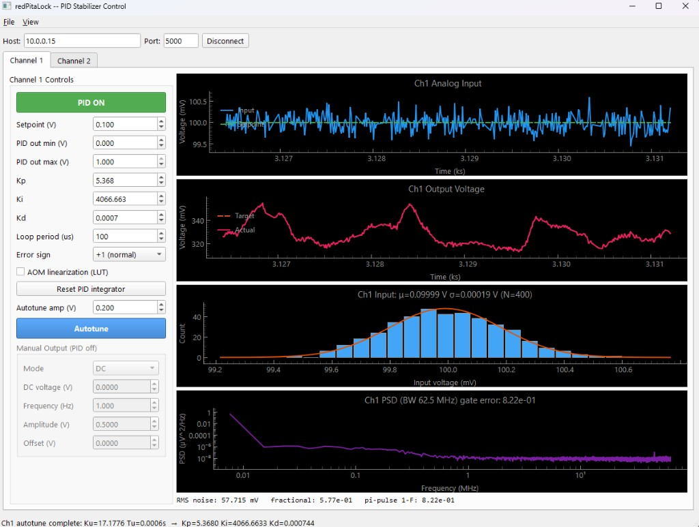
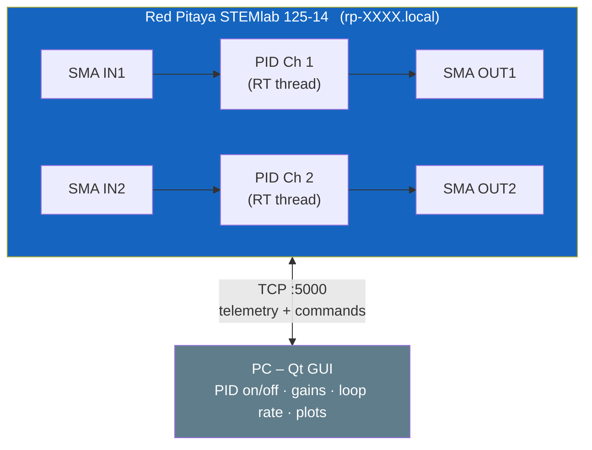
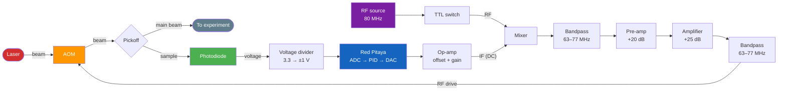

# redPitaLock

Two-channel PID intensity stabilizer for the **Red Pitaya STEMlab 125-14**,
with a Qt-based remote control GUI.

The system reads photodiode signals on the Red Pitaya's fast analog inputs
(IN1, IN2) and outputs corrective voltages on the fast analog outputs
(OUT1, OUT2) to stabilize laser intensity through an AOM or similar actuator.





## System diagram (per channel)



**Optical loop:** The laser passes through the AOM; a pickoff sends a sample to the photodiode. A resistive voltage divider scales the photodiode signal to the Red Pitaya's ±1 V input range. The Red Pitaya's PID loop closes the feedback by outputting a corrective voltage through an op-amp conditioning stage.

**RF drive chain:** An 80 MHz source enters a TTL switch, then a mixer whose IF port receives the Red Pitaya's DC control voltage. The mixed signal passes through a bandpass filter (63–77 MHz), a pre-amplifier (+20 dB), a power amplifier (+25 dB), a second bandpass filter, and finally drives the AOM.

## Features

- **Two independent PID channels** using 14-bit, 125 MS/s fast analog I/O
- Both channels **disabled by default** -- enable from the GUI
- Adjustable PID gains (Kp, Ki, Kd), setpoint, loop rate, and error sign
- **One-click PID autotune** using relay-feedback (Astrom-Hagglund) with Tyreus-Luyben tuning rules
- Derivative on measurement (not error) to avoid noise amplification
- First-order low-pass filter on ADC input before PID
- Optional AOM linearization lookup table per channel
- Configurable PID output limits (out_min / out_max)
- Anti-windup integral clamping
- **Sample and hold**: freeze the loop (integrator, input filter and DAC output) while the beam is gated off, triggered by an external TTL on a DIO pin, by an input threshold, or manually; bumpless resume with a settle delay
- **Fast power spectral density** (PSD) from 125 MS/s ADC bulk-read with Welch averaging, showing RMS noise, fractional stability, and gate error metrics
- Real-time plots of input voltage, target output, actual output, input distribution, and PSD (pyqtgraph, ~100 Hz)
- The input plot carries a second y axis on the right showing the deviation from the setpoint in percent, (V - setpoint) / |setpoint| * 100; it follows every zoom of the voltage axis.
- Strip-chart time axis: the plots always roll with the newest sample; the mouse wheel over a plot changes the length of the rolling window (0.5 s to 10 min) instead of freezing the axis. The voltage axis auto-ranges on the visible data; scroll or drag on the axis itself to zoom it, and press the small "A" button to return to auto-range.
- Simple text-based TCP protocol (debuggable with `telnet`)

## Repository Structure

```
redPitaLock/
├── firmware/
│   ├── Makefile              # Build on the Red Pitaya
│   └── src/
│       ├── main.c            # Daemon: two RT PID threads + TCP server
│       ├── config.h          # Default parameters (gains, rates, scaling)
│       ├── pid.c / pid.h     # PID algorithm with anti-windup
│       ├── autotune.c / .h   # Relay-feedback autotune (Astrom-Hagglund)
│       ├── psd.c / psd.h     # On-chip PSD via FFT (Welch averaging)
│       ├── aom_lut.c / .h    # AOM drive linearization lookup table
│       ├── analog_io.c / .h  # librp fast analog I/O abstraction
│       └── tcp_server.c / .h # Telemetry streaming + command parser
├── scripts/
│   ├── monitor_rp.py         # PySide6 Qt control GUI
│   ├── test_hold.py          # TCP test of the sample-and-hold logic (no GUI)
│   └── requirements.txt      # Python dependencies
├── .gitignore
└── README.md
```

## Hardware Setup

### Voltage Ranges

The Red Pitaya fast I/O operates at **+/-1 V** (LV jumper setting), which
differs from the original 0-3.3 V Pico setup. External signal conditioning
is required:

| Signal | Pico Range | RP Fast I/O Range | Recommended Conditioning |
|--------|-----------|-------------------|--------------------------|
| Photodiode input | 0-3.3 V | +/-1 V (LV) | 3.3:1 resistive voltage divider |
| AOM drive output | 0.18-1.25 V | +/-1 V | Op-amp offset + gain stage |

The firmware has per-channel `input_scale`, `input_offset`, `output_scale`,
and `output_offset` parameters adjustable at runtime via the GUI or TCP
commands.

### Connections

| Red Pitaya Port | Signal |
|-----------------|--------|
| SMA IN1 | Photodiode channel 1 (through voltage divider) |
| SMA OUT1 | AOM drive channel 1 (through conditioning circuit) |
| SMA IN2 | Photodiode channel 2 (through voltage divider), or the sample-and-hold gate TTL for channel 1 (`hold_mode 3`) |
| SMA OUT2 | AOM drive channel 2 (through conditioning circuit) |
| E1 pin 3 (DIO0_P) | Sample-and-hold gate TTL, channel 1 (3.3 V logic) |
| E1 pin 5 (DIO1_P) | Sample-and-hold gate TTL, channel 2 (3.3 V logic) |
| E1 pin 25 / 26 | GND for the gate signals |
| Ethernet | Network connection to PC |

### Sample-and-hold gate wiring

The E1 digital inputs are **3.3 V LVCMOS and not 5 V tolerant** (absolute
maximum about 3.85 V). For a 5 V TTL control line, tee the signal at the RF
switch's control input and add a divider at the header: 1 kΩ in series,
1.8 kΩ from the pin to GND (5 V -> 3.2 V). A 3.3 V logic signal can be
connected directly. The pin index is selectable per channel (`hold_pin`,
n selects DIO<n>_P), as is the polarity (`hold_pol`).

**No divider needed: TTL on the other analog input.** With `hold_mode 3` the
gate is taken from the *other* fast analog input (IN2 gates channel 1, IN1
gates channel 2). The LV input tolerates up to 6 V DC, so a 5 V TTL can be
connected directly; it simply reads as +1 V. The level is compared with
`hold_thresh` (0.5 V for TTL) with `hold_hyst` of hysteresis and `hold_pol`
selects whether LOW or HIGH means hold. This costs the second PID channel its
input.

## Building the Firmware

The firmware is compiled **on the Red Pitaya** itself (ARM Linux with `gcc`
and `librp` pre-installed).

```bash
# From your PC -- copy the source to the Red Pitaya
scp -r firmware/ root@rp-XXXX.local:/root/redPitaLock/

# SSH into the Red Pitaya (default password: root)
ssh root@rp-XXXX.local

# Build
cd /root/redPitaLock/firmware
make

# Run (requires root for real-time thread priority)
./stabilizer_rp
```

If the Red Pitaya web apps are running and conflict with the FPGA
acquisition/generation, stop them first:

```bash
systemctl stop redpitaya_nginx
```

### Running as a Service

To start automatically on boot:

```bash
cat > /etc/systemd/system/stabilizer.service << 'EOF'
[Unit]
Description=redPitaLock PID Stabilizer
After=network.target

[Service]
ExecStart=/root/redPitaLock/firmware/stabilizer_rp
Restart=on-failure
Nice=-20

[Install]
WantedBy=multi-user.target
EOF

systemctl enable stabilizer
systemctl start stabilizer
```

## Running the GUI

On your PC:

```bash
cd scripts/
pip install -r requirements.txt
python monitor_rp.py                    # default: rp-XXXX.local:5000
python monitor_rp.py 192.168.1.100     # explicit IP
python monitor_rp.py rp-XXXX.local 5000  # explicit host + port
```

### Recording to HDF5

The bar below the connection settings records everything the GUI receives
into one `.h5` file per run:

1. **Folder…** chooses the target folder (remembered between sessions).
2. An optional **Note** is stored in the file.
3. **● Start recording** creates `redpitalock_<date>_<time>.h5` in that folder
   and turns into **■ Stop and save**; the label next to it shows the elapsed
   time and sample count. Data is flushed to disk once per second.

File layout (open with `h5py` or HDFView):

```
/                      attrs: format, host, port, note, start_time_iso, stop_time_iso,
                       duration_s, history_window_s, connected
/commands              (t_s, command) -- every command the GUI sent while recording
/ch0, /ch1             one dataset per telemetry column (same ~100 Hz samples the
                       plots show): host_time_s, board_time_s, input_V, raw_V,
                       target_out_V, actual_out_V, setpoint_V, enabled, holding,
                       gate, level  (each with 'unit' and 'description' attrs)
                       attrs: params_start_<key> / params_end_<key> -- the complete
                       board parameter set (the P line: setpoint, gains, limits,
                       loop period, hold settings, loop_actual, ...) when the
                       recording started and when it stopped; n_samples
```

```python
import h5py
with h5py.File("redpitalock_20261015_143000.h5") as f:
    t  = f["ch0/host_time_s"][:] - f.attrs["start_time_unix_s"]
    pd = f["ch0/input_V"][:]
    sp = f["ch0/setpoint_V"][:]
    print(dict(f["ch0"].attrs))          # Kp, Ki, setpoint, ... at start and end
    print(f["commands"][:])              # what was changed, and when
```

### GUI Controls (per channel)

| Control | Description |
|---------|-------------|
| **PID ON/OFF** | Toggle PID feedback (off by default) |
| **Setpoint (V)** | Target photodiode voltage |
| **Kp, Ki, Kd** | PID gains |
| **Loop period (us)** | Control loop update interval |
| **Error sign** | +1 (normal) or -1 (inverted feedback) |
| **AOM linearization** | Enable/disable the AOM drive lookup table |
| **PID out min / max (V)** | Output clamp range for the PID controller |
| **Reset PID integrator** | Zero the integral accumulator |
| **Integral max** | Anti-windup clamp on the integrator state; its output contribution is Ki x this value, so keep it above out_max / Ki (default 0.5, 0 disables integral action) |
| **Autotune amp (V)** | Relay half-amplitude for autotune excitation |
| **Autotune** | Start/cancel relay-feedback autotune; shows live progress |
| **Tools > Optimize PID gains** | Runs `scripts/optimize_pid.py` for the current channel: searches kp/ki until the relative fluctuation is below 1 % (see below) |
| **Tools > Sweep PID gains** | Runs `scripts/sweep_pid.py`: fluctuation on a kp x ki grid around the current gains, shown live as a heatmap (see below) |
| **Tools > Step response test / Optimize step response** | Runs `scripts/optimize_step.py`: measures the settle time after a setpoint step at the loop rate, or searches kp/ki until it is below 1 ms (see below) |
| **HOLD now** | Manual sample-and-hold: freeze the PID output immediately (any mode) |
| **Setpoint source** | Internal (the Setpoint field) or External: the setpoint follows the control voltage on the other input (see below) |
| **Measure laser range** | Ramps the output to PID out min and to PID out max, averages the input at both, and sets the setpoint range the control voltage scales over |
| **TTL level** LED | Raw level of the gate source (green HIGH, dark LOW), independent of the polarity setting |
| **Gate source** | Off / External TTL (DIO) / Input threshold / TTL on the other analog input |
| **DIO pin (E1), Hold while pin/input** | Which DIO<n>_P pin gates the hold (DIO mode), and at which level (DIO and analog-TTL modes) |
| **Threshold, Hysteresis (V)** | Threshold mode: hold while raw input < threshold, release above threshold + hysteresis. Analog-TTL mode: LOW/HIGH decision level (preset 0.5 V / 0.1 V) |
| **Debounce (samples)** | Consecutive gated loop iterations before the hold engages |
| **Resume delay (us)** | Keep holding this long after the gate releases, so the plant can settle |
| **Hold lookback (ms)** | Hold the output from this long *before* the gate instead of the last output (for a TTL that arrives after the beam is already gone) |
| **Hold average (ms)** | Average the held output over a window of this length ending at the lookback point |
| **Park output while holding** | Drive a fixed park voltage during the hold instead of the last PID output |

### Sample and hold

When the gate asserts while the PID is on, the loop enters **HOLD**: the
integrator and the input low-pass filter are frozen and the DAC keeps the last
PID output (or the park voltage). A running autotune is aborted. When the gate
releases, the loop waits `resume_delay` and then resumes **bumplessly**: the
filter restarts on fresh data and the integrator is re-seeded so the first new
PID output equals the held output. The gate state is evaluated and reported
even while the PID is off, so wiring and polarity can be checked on the status
lamp before closing the loop. Hold intervals are shaded on the input plot.

With the TTL switch upstream of the mixer, the Red Pitaya output has no effect
on the beam during a gap, so "hold last output" (the default) is the right
choice; "park" is for setups that need the RF drive off.

**Which output is "the last"?** By default the output of the loop iteration
before the gate asserted. If the TTL reaches the Red Pitaya only after the
beam is already off (slow shutter, a late trigger, or just the 2-sample
debounce), that output already contains the controller's reaction to the dark
photodiode: a proportional kick and some integrator wind-up, which then gets
frozen into the hold and shows up as a step on the output plot. `hold_lookback`
takes the output from that long before the gate instead, and `hold_avg`
averages over a window of that length ending at the lookback point. A good
start is lookback = the measured TTL lag plus the debounce time, average 50 to
100 ms.

### External setpoint (control voltage on IN2)

The setpoint of channel 1 can follow an analog control voltage of 0 to 1 V
on IN2 (and the setpoint of channel 2 one on IN1):

    setpoint = min_setpoint + (max_setpoint - min_setpoint) x clamp(IN2 / full_scale, 0, 1)

The range is found by a two-point calibration ("Measure laser range" in the
GUI, `SET <ch> spcal 1` on the wire): the output ramps to *PID out min*
(`spcal_ramp_ms`, default 200 ms), waits `spcal_avg_ms`, averages the input
for `spcal_avg_ms` (default 100 ms) -> *zero*; ramps to *PID out max*, waits
and averages again -> *full*; then

    min_setpoint = zero
    max_setpoint = zero + sp_ext_pct / 100 x (full - zero)          (default 90 %)

and ramps the output back to where it was; a running PID resumes bumplessly
at its old output. The whole measurement takes 3 ramps + 4 wait periods
(about 1 s with the defaults). Only samples with the hold gate idle (beam
on) are averaged, so a TTL-pulsed beam is handled: the averaging window
extends until enough beam-on samples were seen (at most 50 x `spcal_avg_ms`).
It fails (range unchanged) when the beam never came on or full - zero is
below 1 mV. *zero* may be negative (a photodiode amplifier with a dark
offset below 0 V, or the ADC offset): the minimum setpoint is then negative
and the control voltage still scales linearly from that minimum up to the
maximum; nothing in the chain clamps the range to 0 V. The percentage can be changed afterwards; the max setpoint is
rescaled from the last measurement. Both ends of the range can also be
typed in directly (`sp_ext_min`, `sp_ext_max`).

Note that *zero* is measured at *PID out min*. If the light is not minimal
at 0 V (an offset in the RF mixer or driver puts the minimum of the
diffracted power at a slightly positive IF voltage), set *PID out min* to
that voltage: the controller then never crosses into the region where the
slope reverses, and the calibration measures the real minimum.

The control voltage is low-pass filtered (`sp_ext_alpha`, default 0.2 =
same corner as the input filter) and clamped to 0..`sp_ext_ref` (default
1 V), so a control voltage above full scale gives the max setpoint and a
negative one gives zero. Switching back to the internal source restores the
setpoint that was last typed into the Setpoint field. In external mode the
telemetry and the GUI setpoint show the live value, and the panel shows
the control voltage and the resulting setpoint. Reading the second input
costs one more ADC read per loop iteration (a few microseconds).

Hold mode 3 (TTL on the other input) and the external setpoint both use the
other input and cannot be combined; use the DIO pin for the TTL gate.

### Automatic gain optimisation (`scripts/optimize_pid.py`)

```
python optimize_pid.py rp-XXXX.local --dry-run        # just measure the fluctuation
python optimize_pid.py rp-XXXX.local                  # optimise channel 1 to < 1 %
python optimize_pid.py rp-XXXX.local --ch 1 --target 0.5 --measure 6 --kd
```

The metric is the standard deviation of the photodiode voltage divided by the
setpoint, measured over a window (4 s by default) with held samples and the
0.3 s after each hold excluded. Starting from the current gains the script
first scans a coarse grid (kp x 0.3..3, ki x 0.1..10; `--no-grid` skips it)
and then does a coordinate descent on log(ki) and log(kp) with multiplicative
steps (2.0, shrinking to 1.1): each candidate is applied, the loop is given a settle
time, the fluctuation is measured, and the candidate is kept only if it is at
least 2 % better. Candidates that saturate the output, that produce a spectral
line (oscillation) or that blow up the fluctuation are rejected and the
previous best is restored. The search stops when the target is reached and
confirmed by a longer measurement, when the step is exhausted, or after
`--max-evals`. Ctrl-C restores the original gains. `integral_max` is set to
1.2/ki whenever ki changes so the anti-windup clamp stays meaningful, and the
firmware rescales the integrator on a ki change so the output does not jump.

If the target cannot be reached the script says so and names the likely
limit: ADC quantisation (one LSB of the +/-1 V input is 0.12 mV, i.e. 0.3 %
of a 40 mV signal: raise the signal level), the loop bandwidth (shorten the
loop period) or noise above the loop bandwidth (see the PSD view). Also
available from the GUI: Tools > Optimize PID gains, which opens the script in
a console for the current channel; afterwards use Tools > Refresh parameters
from board to update the gain fields.

### Gain sweep with live heatmap (`scripts/sweep_pid.py`)

```
python sweep_pid.py rp-XXXX.local                 # 7 x 7 grid, 0.1x .. 10x the current kp and ki
python sweep_pid.py rp-XXXX.local --n 9 --kp-range 0.5 --ki-range 1.5 --measure 3
```

Walks a logarithmic kp x ki grid around the current gains (centre first), measures
the relative fluctuation of every cell at the loop rate (held samples excluded)
and fills a heatmap live, with the number in each cell. Cells where the output
saturates or an oscillation line appears are marked `sat` / `osc`. The best
unflagged cell is circled; "Apply best", a click on a cell, or "Restore
original" send gains to the board. Closing the window restores the original
gains unless a cell was applied. Also in the GUI: Tools > Sweep PID gains.

### Step response and switching-time optimisation (`scripts/optimize_step.py`)

```
python optimize_step.py rp-XXXX.local --dry-run                 # one up/down step, print metrics, save CSV
python optimize_step.py rp-XXXX.local                           # optimise kp/ki for settle time < 1 ms
python optimize_step.py rp-XXXX.local --delta-pct 5 --capture-ms 10 --target-ms 0.5 --kd
```

The firmware records a setpoint step at the loop rate (`SET <ch> step
<delta_v>`, capture length `step_ms`, pre-trigger `step_pre_ms`; the capture
is streamed back as a `STEP` header plus `S <t_us> <input> <output>` lines), so
the timing resolution is the loop period rather than the 100 Hz telemetry.
Each test is a step up by `--delta-pct` of the setpoint and a step back down;
the reported settle time is the time after the step until the input stays
within `--band` (1 %) of the new setpoint for the rest of the capture, the
rise time is 10 % to 90 %, and the overshoot is relative to the step. The
optimiser is the same grid scan plus coordinate descent as above (grid
kp x 0.3..10, ki x 0.1..10), minimising the settle time and rejecting
candidates that overshoot more than `--max-overshoot`, ring, or never settle.
All decisions are taken on a ~200 us moving average of the trace, and the
settling band is widened to 4 sigma of the averaged loop noise (measured on
the pre-trigger samples) when that is wider than `--band`, so a noisy but
stable loop still gets a settle time. A hold during a capture aborts it and
the test is repeated.

A 1 ms settle time needs a loop period of about 100 us or less (the loop needs
several iterations to settle), and is ultimately bounded by the input filter
(corner at about 4 loop periods), the AOM/RF/photodiode response and the
output limits. The script prints these hints when the target is not reached.

## TCP Protocol

The daemon listens on port 5000. Connect with `telnet rp-XXXX.local 5000`
to debug.

### Telemetry (server -> client, ~100 Hz)

```
D <ch> <time_s> <input_V> <target_out_V> <actual_out_V> <setpoint_V> <enabled> <holding> <gate> <level> <raw_V>
AT <ch> <crossings> <measured_cycles> <elapsed_s>    # while autotune is running
A <ch> <Ku> <Tu> <Kp> <Ki> <Kd>                       # autotune completed
AF <ch>                                               # autotune failed (timeout)
```

`holding` is 1 while the PID output is frozen by the sample-and-hold logic;
`gate` is the raw gate state (reported even when the PID is off); `level` is
the raw level of the gate source (1 HIGH, 0 LOW, -1 when no source is
selected), shown as the "TTL level" LED in the GUI. `input_V` is the
low-pass-filtered input the PID acts on; `raw_V` is the unfiltered ADC sample
of the same loop iteration (View > Show raw ADC samples in the GUI; the
statistics box on the input plot reports the std of both).

Example:
```
D 0 12.345678 0.4832 0.7521 0.7521 0.5000 1 0 0
D 1 12.345680 0.3210 0.0000 0.0000 0.5000 0 0 1
AT 0 4 1 2.3
A 0 12.3456 0.0234 5.5555 284.3210 0.000744
```

### Commands (client -> server)

```
SET <ch> enabled 1              # enable PID
SET <ch> enabled 0              # disable PID
SET <ch> setpoint 1.500         # set target voltage
SET <ch> kp 4.0                 # proportional gain
SET <ch> ki 2.0                 # integral gain
SET <ch> kd 0.04                # derivative gain
SET <ch> loop_rate 1000         # loop period in microseconds
SET <ch> error_sign 1.0         # feedback polarity (+1 or -1)
SET <ch> use_lut 1              # enable AOM linearization
SET <ch> in_scale 3.3           # input calibration scale
SET <ch> in_offset 0.0          # input calibration offset
SET <ch> out_scale 1.0          # output calibration scale
SET <ch> out_offset 0.0         # output calibration offset
SET <ch> out_min 0.0            # minimum PID output (V)
SET <ch> out_max 1.0            # maximum PID output (V)
SET <ch> reset 0                # reset PID integrator
SET <ch> autotune 1             # start relay-feedback autotune
SET <ch> autotune 0             # cancel autotune
SET <ch> autotune_amp 0.5       # relay half-amplitude (V)
SET <ch> autotune_hyst 0.005    # hysteresis band (V)
SET <ch> hold 1                 # manual sample-and-hold on (0 = release)
SET <ch> hold_mode 1            # gate source: 0 off, 1 external TTL (DIO), 2 input threshold,
                                #              3 TTL on the other analog input (IN2 for ch 0)
SET <ch> hold_pin 0             # DIO<n>_P pin index 0..7 (DIO mode)
SET <ch> hold_pol 0             # 0: hold while pin/input LOW, 1: hold while HIGH (modes 1 and 3)
SET <ch> hold_thresh 0.05       # mode 2: hold while raw input < this (V); mode 3: LOW/HIGH level (0.5 for TTL)
SET <ch> hold_hyst 0.01         # release when input > thresh + hyst (V)
SET <ch> hold_debounce 2        # consecutive gated samples before holding
SET <ch> resume_delay 200       # keep holding this long after release (us)
SET <ch> hold_lookback 0        # hold the output from this long before the gate (ms, 0 = last)
SET <ch> hold_avg 0             # average the held output over this window (ms, 0 = one sample)
SET <ch> hold_park 0            # 1: drive hold_park_v while holding
SET <ch> hold_park_v 0.0        # park voltage (V)
SET <ch> hold_count_reset 0     # zero the hold event counter
# GET <ch> params also reports loop_actual=<us>, the loop period the CPU really achieves
# (the requested loop_rate is only a lower bound; on OS 3.x boards ~50 us is the floor).
SET <ch> sp_source 1            # 0: setpoint from SET setpoint, 1: follow the control voltage on the other input
SET <ch> sp_ext_pct 90          # max setpoint = zero + % x (full - zero) (rescales sp_ext_max)
SET <ch> sp_ext_min 0.002       # setpoint at zero control voltage (V)
SET <ch> sp_ext_max 0.045       # setpoint at the control full scale (V)
SET <ch> sp_ext_ref 1.0         # control voltage full scale (V)
SET <ch> sp_ext_alpha 0.2       # LPF coefficient on the control voltage (1 = unfiltered)
SET <ch> spcal_ramp_ms 200      # calibration: output ramp time (ms)
SET <ch> spcal_avg_ms 100       # calibration: settle and averaging time (ms)
SET <ch> spcal 1                # start the range measurement (0 = abort); ERR when busy
                                # GET params reports spcal_state (0 idle, 1-8 running, 9 done, 10 failed),
                                # spcal_zero / spcal_full (input at out_min / out_max), spcal_out_min / spcal_out,
                                # sp_user (the typed setpoint)
SET <ch> step_ms 20             # step capture: length after the step (ms)
SET <ch> step_pre_ms 1          # step capture: pre-trigger length (ms)
SET <ch> step 0.0015            # apply a setpoint step of +0.0015 V, record at loop rate,
                                # stream back "STEP <ch> <n> <pre_n> <period_us> <sp_before> <delta> ok|aborted"
                                # followed by n lines "S <t_us> <input_V> <output_V>"; the setpoint is restored
GET <ch> params                 # query all parameters (includes hold_* and hold_count)
```

## PID Algorithm

- **P term:** `Kp * error`
- **I term:** `Ki * integral`, with clamping to `+/-integral_max` and
  anti-windup (integral freezes when output saturates in the same direction
  as the error)
- **D term:** `Kd * d(measurement)/dt` (derivative on measurement, not error,
  to avoid kick on setpoint changes and reduce noise amplification)
- **Input filter:** first-order IIR low-pass on ADC before PID (`INPUT_LPF_ALPHA`)
- **Output** clamped to `[out_min, out_max]` (default 0-1 V)

When the AOM LUT is enabled, the normalized 0-1 PID output is mapped through
a 13-point piecewise-linear curve to the physical AOM drive voltage
(~0.18-1.25 V).

## Autotune

The autotune uses the **Astrom-Hagglund relay-feedback** method:

1. Enable PID and set a valid setpoint
2. Click **Autotune** -- the PID is temporarily replaced by a bang-bang relay
3. The relay forces the output to oscillate around the setpoint, swinging
   between `center + amp` and `center - amp` (center = current output voltage)
4. After discarding 1 settle cycle, the firmware measures the oscillation
   period (Tu) and peak-to-peak amplitude (a) over 3 full cycles
5. Ultimate gain and PID gains are computed using **Tyreus-Luyben** rules:
   - `Ku = 4d / (pi * a)` where d = relay amplitude
   - `Kp = Ku / 3.2`, `Ki = Ku / (7.04 * Tu)`, `Kd = Ku * Tu / 13.86`
6. Gains are written into the PID and normal control resumes
7. The GUI spinboxes update automatically with the computed gains

The autotune respects `error_sign` so it works with both normal and inverted
plant polarity. A 30-second timeout aborts if no oscillation is detected.

## Origin

Ported from [stabilizerPi](https://github.com/beneaze/stabilizerPi), a
Raspberry Pi Pico-based single-channel laser intensity stabilizer.
